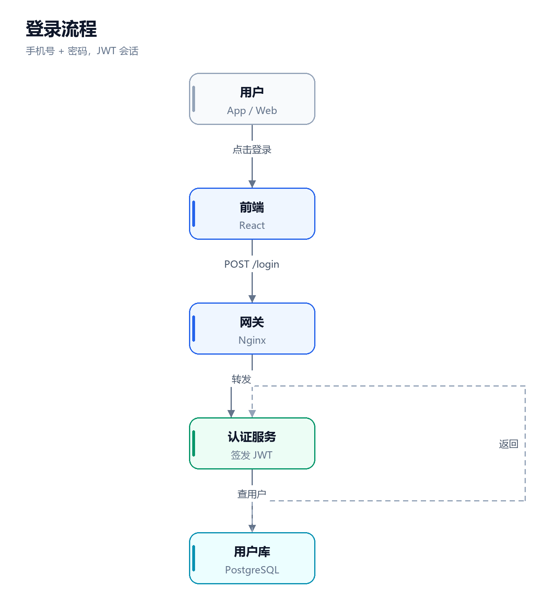
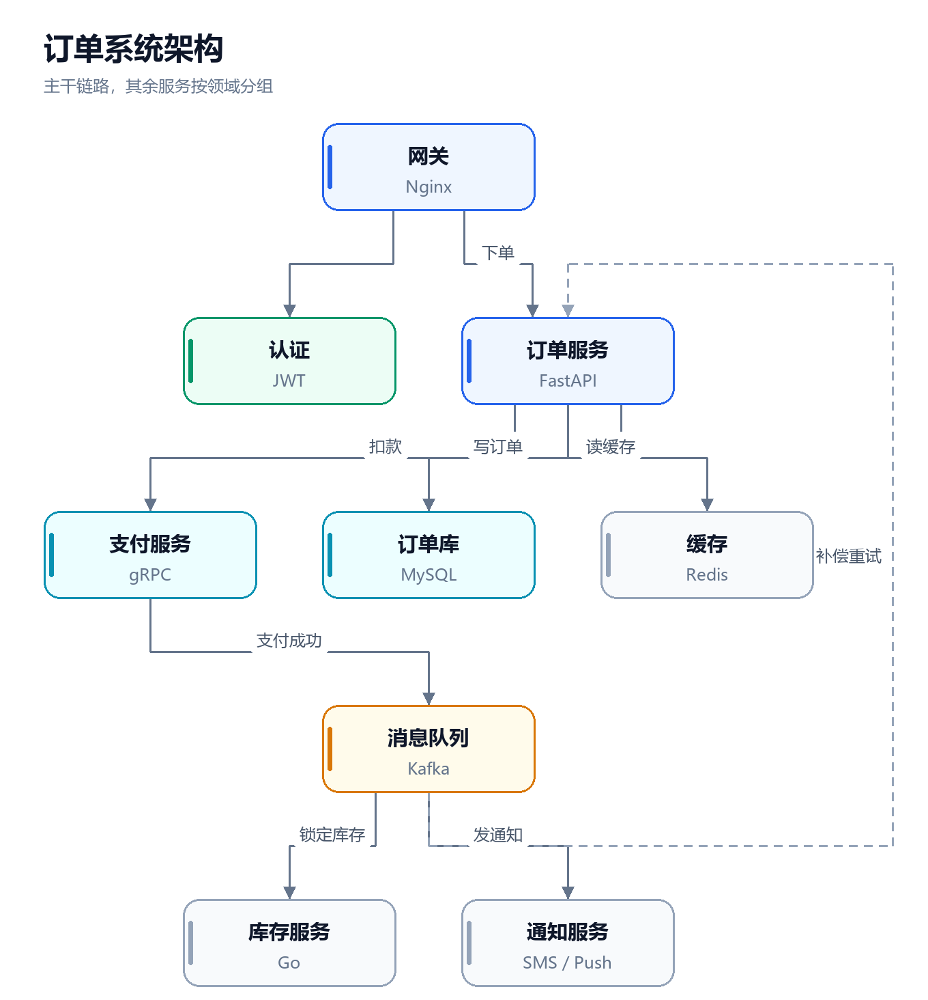
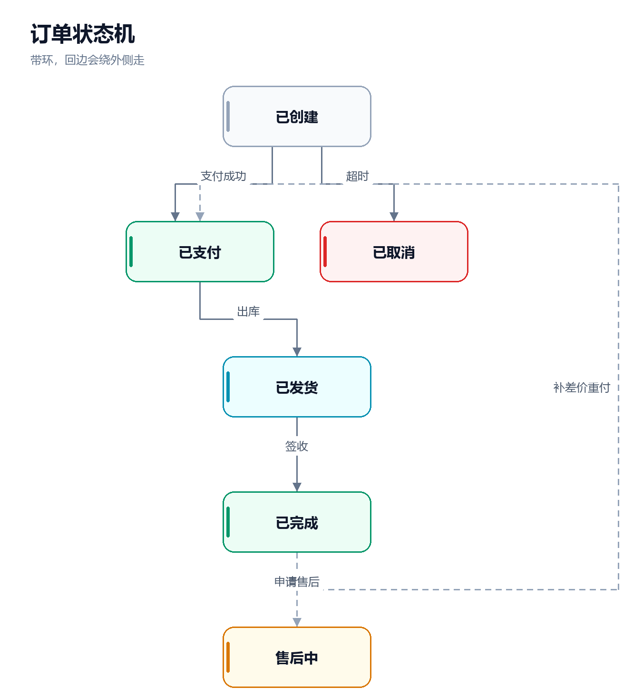
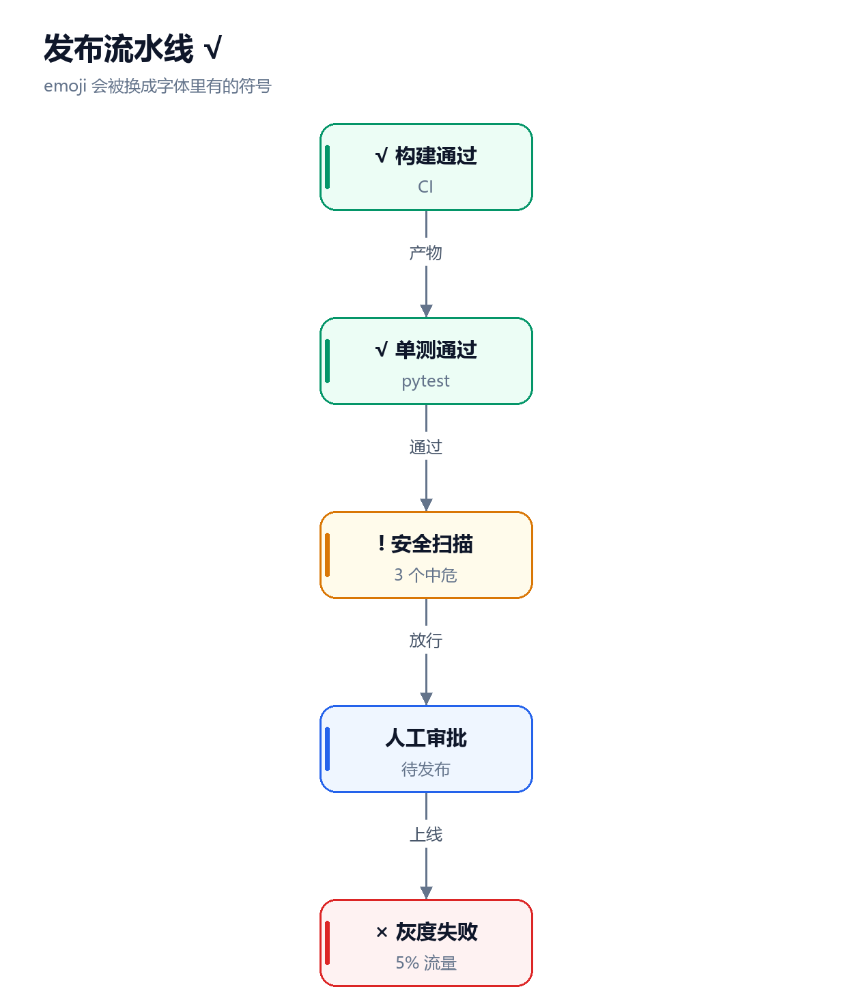

# 图匠 · ChartSmith

> 让 AI 把流程、架构、调用链画成一张**排版好的图片**，直接发到 QQ / Telegram / 飞书里，而不是甩一堆文字。

<p>
  
  
  
  
  
</p>

`render_diagram` 一个工具，模型只给节点和连线，插件负责分层、走线、配色，然后用 Pillow 在本地直接画成 PNG 发出去。

| 登录流程 | 订单系统架构 | 状态机（带回边） |
|---|---|---|
|  |  |  |

---

## 目录

- [为什么做这个](#为什么做这个)
- [特点](#特点)
- [快速开始](#快速开始)
- [使用](#使用)
- [结构 JSON 契约](#结构-json-契约)
- [配置项](#配置项)
- [QQ / Telegram 适配](#qq--telegram-适配)
- [工作原理](#工作原理)
- [开发](#开发)
- [常见问题](#常见问题)
- [已知限制](#已知限制)
- [更新日志](#更新日志)
- [License](#license)

---

## 为什么做这个

聊天平台没有 DOM，AstrBot 的消息段只有 `Plain` / `Image` / `At` 这几种——所谓的「卡片」只能是**渲染好的位图**。
所以链路只能是：**模型给结构 → 插件算布局 → 渲染 PNG → 当图片消息发出去**。

为什么不直接用 AstrBot 的 `html_render()`？它会把 HTML 模板 POST 给远程文转图服务再拿图片 URL：
每张图都要过一次外网、内容会离开本机、服务抖一下插件就报错。
图匠换了个更省的做法：**布局和绘制都在本地、用 Pillow 画**。Pillow 本来就是 AstrBot 的依赖，
所以插件本身**零额外依赖**，不需要 node、Playwright、mermaid-cli，Docker 镜像也不用加东西。

代价是版式要自己算——这就是 `layout.py` 存在的理由。

---

## 特点

- **稳定的版式**：最长路径分层 + 两轮重心排序 + 正交走线。回边走图外侧的独立轨道，不会从别的节点背后穿过去。
- **本地渲染**：一次出图几十毫秒，离线可用；图片落在 `data/plugin_data/`，不依赖 URL 是否过期。
- **手机优先**：默认 2 倍像素输出；自动在上下（TB）和左右（LR）里挑更窄的版本——手机按屏宽缩放，越窄字越大。
- **聊天友好**：图片和说明合成一条消息（QQ 一个气泡发完）；发图失败兜底成文字，不会让群里静默。
- **模型无关**：JSON 契约里没有坐标字段，模型不用学布局，换哪家模型都一样。
- **不刷屏**：每会话每分钟限流、按内容哈希缓存、超限节点自动截断并注明。

---

## 快速开始

### 1. 安装插件

**插件市场**（推荐）

WebUI → 插件 → 插件市场 → 搜索 `图匠` 或 `ChartSmith` → 安装。

**手动安装**

```bash
# 注意：目录名必须和 metadata.yaml 里的 name 一致
cd AstrBot/data/plugins
git clone https://github.com/Bb18273645/astrbot_plugin_chartsmith.git
```

然后在 WebUI 的插件页点刷新图标重载。

> 不需要 `pip install` 任何东西，也不要额外装浏览器。

### 2. 配置提示词

WebUI → 人格 → 你正在用的 persona → 把 [`提示词.md`](提示词.md) 第 ① 节贴到系统提示词末尾。

这一步决定模型「什么时候画」和「怎么给结构」，强烈建议做。

### 3. 试一下

私聊机器人：

```
画一下登录流程：用户 → 前端 → 网关 → 认证服务 → 数据库
```

---

## 使用

### 让模型自己画

```
画一下我们订单系统的架构
画一个订单状态机，要能看出退款流程
```

模型会调用 `render_diagram`，图片直接出现在聊天里，随后它只用一两句话补充结论。

### 手动调试

不经过模型，直接渲染一段 JSON，用来验证链路和版式：

```
/diagram {"title":"测试","nodes":[{"id":"a","label":"A"},{"id":"b","label":"B"}],"edges":[{"from":"a","to":"b","label":"调用"}]}
```

中文别名 `/图匠` 等价。JSON 不合法、节点为空、渲染失败都只回一句文字提示，不会崩。

---

## 结构 JSON 契约

```json
{
  "title": "会话建立流程",
  "subtitle": "可选一行说明",
  "direction": "TB",
  "nodes": [
    {"id": "client", "label": "客户端", "sub": "浏览器", "tone": "neutral"},
    {"id": "gw", "label": "网关", "sub": "Nginx", "tone": "brand"}
  ],
  "edges": [
    {"from": "client", "to": "gw", "label": "HTTPS", "style": "solid"}
  ]
}
```

| 字段 | 取值 | 说明 |
|---|---|---|
| `title` | 字符串 | 图标题，≤ 32 字 |
| `subtitle` | 字符串 | 可选，一行补充说明 |
| `direction` | `TB` / `LR` / 省略 | 从上到下 / 从左到右；省略时插件挑更窄的版本 |
| `nodes[].id` | 短英文 | 连线用；重复 id 会被丢弃 |
| `nodes[].label` | 中文，≤ 14 字 | 方框主标题 |
| `nodes[].sub` | 字符串，≤ 18 字 | 副标题，一般放技术栈 |
| `nodes[].tone` | `neutral` `brand` `info` `success` `warn` `error` | 方框强调色 |
| `edges[].from` / `edges[].to` | 节点 id | 端点不存在或自环的边会被丢弃 |
| `edges[].label` | 字符串，≤ 12 字 | 连线上的小标签 |
| `edges[].style` | `solid`（默认）/ `dashed` | 虚线一般表示回调、重试、异步 |
| 上限 | 16 节点 / 24 连线 | 超了会截断，并在图下方注明省略数量 |

**不给坐标**：坐标是插件的责任，契约里也没有 x/y 字段，模型想给也没地方放。

**文字会被清洗**：`✅ ❌ ⚠ 🚀` 这类 emoji 在中文字体里没有字形，会渲染成豆腐块。插件把常见几个换成 `√ × !`，
其余 emoji 删掉；`★ → ①` 这类字体里有的符号会保留。



---

## 配置项

| 配置 | 默认 | 说明 |
|---|---|---|
| `max_nodes` | 16 | 单图节点上限，超出截断并注明 |
| `max_edges` | 24 | 单图连线上限 |
| `per_minute` | 6 | 每会话每分钟最多渲染几张，`0` 不限 |
| `max_parallel` | 2 | 同时渲染张数，按机器调整 |
| `scale` | 2 | 输出像素倍率：2 倍像素手机上最清晰，1 省流量，3 更细但更慢 |
| `max_width` | 2048 | 输出宽度上限，超过等比缩小 |
| `max_height` | 3200 | 输出高度上限，长链路竖图靠它兜底 |
| `auto_direction` | 开 | 自动在 TB / LR 里挑更窄的排版 |
| `font_path` | 空 | 中文字体路径，空则自动探测（Windows 雅黑 / macOS 苹方 / Linux Noto CJK） |

渲染结果按 `sha256(spec)` 缓存到 `data/plugin_data/astrbot_plugin_chartsmith/cache/`，7 天过期、最多 200 张。

---

## QQ / Telegram 适配

聊天场景和网页预览不一样，下面这些是专门为此做的：

**一条消息发完**

- QQ（aiocqhttp / NapCat）会把「图片 + 说明文字」合成**同一条消息**，不会出现「图一条、字一条」的碎片感；
  超限裁剪的提示（`已省略 N 个…`）也是跟图一起发的。
- Telegram 的 Bot API 不支持给现有的图补说明，所以 TG 上是「图片」+「一行说明」两条消息，顺序固定图在前。
- 发送失败（NapCat 上传超时、TG 侧拒绝）会兜底成一句文字提示，不会把异常抛给模型或让群里静默无响应。

**手机上看得清**

- 输出默认 **2 倍像素**：手机会把图缩放铺满屏宽，1 倍渲染的 12px 字会被拉糊。
- 宽 / 高有上限（`max_width=2048`、`max_height=3200`），超了等比缩小——群图太大会被 QQ 二次压缩，反而更糊。
- **自动挑方向**：手机按屏宽缩放，所以**越窄的图字越大**。横向铺开的大扇出会变成 LR，长链路仍然是 TB 长图。

**群聊里怎么触发**

- QQ 群里需要 @机器人 或带唤醒前缀（取决于 AstrBot 的唤醒设置），私聊直接说需求即可。
- Telegram 群里需要在 BotFather 关掉 privacy mode，或者 @机器人 再说需求。
- 每个会话每分钟默认最多 6 张，超了回一句文字提醒，不会刷屏。

---

## 工作原理

```
用户消息
   │
   ▼
LLM（系统提示词 + render_diagram 工具）
   │  tool_call: {"spec": {...}}          ← 只有节点和边，没有坐标
   ▼
main.py  render_diagram()
   │
   ├─ layout.normalize()      校验 / 裁剪 / 清洗 emoji
   ├─ layout.build_layout_auto()
   │     ├─ Kahn 拓扑排序分层（有环先摘一条环内边）
   │     ├─ 层内两轮重心排序
   │     ├─ 等宽节点 + 层内居中 + 层间固定间距
   │     └─ 正交走线：正向 S 形；回边走外侧独立轨道
   ├─ render.render_layout()  Pillow 2 倍绘制 → PNG → 尺寸上限 → 缓存
   └─ event.send(图片 + 说明)
   │
   ▼
聊天窗口里一张排版好的图 + 模型的一两句话
```

布局的几个关键决定：

1. **分层**：最长路径分层，层号决定上下位置；遇到环先摘掉一条环内边再分层，被摘的边后面按「回边」画回去——状态机那种环不会把整张图压平。
2. **层内排序**：两轮重心（barycenter）迭代，先按父节点位置排、再按子节点位置反向排，压掉大部分交叉。
3. **等宽节点**：一张图里所有方框同宽（按最长标签算，156~280px），层内居中，视觉上整齐。
4. **正交走线**：正向边走「出口 → 层间中线 → 入口」；回边先进层间通道，再走图外侧的独立轨道，最后从目标上方/左侧折入；同一节点的多条出/入边沿边均匀分开。
5. **方向自适应**：同时算 TB / LR，按「宽度为主、高度为辅」挑手机上更好读的那版。

---

## 开发

```
ChartSmith/
├── main.py            # 插件入口：工具、命令、限流、缓存、发送、降级
├── layout.py          # 布局引擎：分层 / 排序 / 走线 / 方向自适应（纯标准库）
├── render.py          # Pillow 渲染：字体探测、方框、箭头、标签、尺寸上限
├── examples.py        # 预览用的示例结构，也是 JSON 契约的可复制样例
├── scripts/preview.py # 生成预览图，用眼睛验收版式
├── tests/             # 单元测试（不需要 AstrBot，渲染用例缺 Pillow 时跳过）
├── preview/           # 预览图
├── docs/              # 插件市场文案、发布说明模板、二改与授权须知
├── CHANGELOG.md       # 更新日志
├── NOTICE             # 版权与上游信息
├── ADDITIONAL-TERMS.md# 依 AGPL §7(b) 的附加署名要求
├── COMMERCIAL-LICENSE.md # 商业许可说明
└── pyproject.toml     # 只放 ruff 的格式/检查配置
```

```bash
# 单元测试（纯标准库 + Pillow）
python -m unittest discover -s tests -v

# 生成预览图到 preview/
python scripts/preview.py

# 格式与静态检查
ruff format . && ruff check .
```

想顺带验证真实 API，可以在 AstrBot 源码目录下跑：

```powershell
$env:PYTHONPATH = 'D:\project\AstrBot\AstrBot-v4.29.4'
& <你的 python> -m unittest discover -s tests -v
```

测试覆盖：结构校验与裁剪、emoji 清洗、分层与成环、节点不重叠、连线不出画布、回边/同层边走线、
方向自适应、2 倍输出与尺寸上限、工具 docstring 的 `Args:` 解析、配置 schema 与代码默认值一致。

---

## 常见问题

**图里的中文是方块 / 豆腐块？**
容器里没装中文字体。装 `fonts-noto-cjk`，或在插件配置里把 `font_path` 指到一个 `.ttc/.ttf` 文件。
插件启动日志会打印实际选中的字体路径（`[chartsmith] ... 中文字体：...`）。

**模型压根不调用工具？**
说明系统提示词没配好。把 [`提示词.md`](提示词.md) 第 ① 节贴到人格里；里面的「什么时候画 / 什么时候不要画」是决定命中率的关键。

**图很糊 / 被压扁？**
`scale` 提到 2 或 3，`max_width` 保持默认；长链路竖图会受 `max_height` 限制等比缩小，属正常。

**画出来一坨交叉线？**
契约里不要出现坐标；节点控制在一屏 12 个以内；连线尽量只连相邻层级的节点。超出上限的节点会被截断并在图下注明。

**发图报错 / 群里没反应？**
看 AstrBot 日志里 `[chartsmith]` 前缀的那几行，通常是 NapCat 上传失败或 TG 侧被限制；插件会兜底回一句文字提示。

**缓存占空间？**
`data/plugin_data/astrbot_plugin_chartsmith/cache/`，7 天自动过期、最多 200 张，最多几十 MB。

---

## 已知限制

- 输出是**静态图片**：聊天平台没有 DOM，点不开、切不了主题。
- 跨层正向连线会从中间层节点背后穿过（提示词里已要求「只连相邻层」）。
- 单图建议 ≤ 12 节点；16 节点的长链路会触发 `max_height` 等比缩小。
- 字体里没有的 emoji 会被替换或删掉，所以图上的表情符号会比模型原文少。
- Telegram 的图不能带 caption，说明文字会单独成一条；QQ 则能合并成一条。
- 颜色固定浅色卡片，暂不支持暗色主题。

后续可做：超长链路自动分页成多张图；解析 Mermaid 后走同一套布局；插件页里加实时预览。

---

## 更新日志

见 [CHANGELOG.md](CHANGELOG.md)。当前版本 **v0.2.0**。

---

## License

本项目采用 **AGPL-3.0-or-later + 商业双许可**：

| 你的情况 | 用哪种许可 | 费用 |
|---|---|---|
| 个人使用、学习研究、自建自用 | AGPL-3.0-or-later | 免费 |
| 二次开发后**按 AGPL 开源**发布 | AGPL-3.0-or-later | 免费（必须附源码、保留声明、标注上游） |
| 集成进**闭源**产品、闭源内部系统 | 商业许可 | 需购买/协商 |
| 做 SaaS，**不想公开**修改后的源码 | 商业许可 | 需购买/协商 |
| 打包进闭源发行版、付费课程、付费整合包 | 商业许可 | 需购买/协商 |

**AGPL 的要点**：允许商业使用，但一旦你把修改版本分发出去、或把它作为网络服务提供给别人用，
就必须以 AGPL 公开完整源代码（包括你的修改）。不想开源，就走商业许可。

- [`LICENSE`](LICENSE)：GNU AGPL-3.0 全文（官方文本）
- [`NOTICE`](NOTICE)：版权与上游信息
- [`ADDITIONAL-TERMS.md`](ADDITIONAL-TERMS.md)：依 AGPL 第 7(b) 条附加的署名与来源说明要求
- [`COMMERCIAL-LICENSE.md`](COMMERCIAL-LICENSE.md)：商业许可能做什么、怎么申请
- [`docs/二改与授权须知.md`](docs/二改与授权须知.md)：场景速查、合规三件套、二改声明模板、FAQ

> 以上是许可摘要，**不构成法律意见**；商业场景请以 `LICENSE`、`ADDITIONAL-TERMS.md`
> 与双方签署的商业许可协议原文为准。

Copyright (c) 2026 Bb18273645.

---

<details>
<summary><b>English</b></summary>

**ChartSmith** is an AstrBot plugin that turns structured flow / architecture descriptions into a
well-laid-out PNG and sends it straight into QQ / Telegram chats.

The model only supplies nodes and edges — the plugin does the layered layout (longest-path layering,
barycenter crossing reduction, orthogonal edge routing with outer rails for back edges) and renders
locally with Pillow. No browser, no remote rendering service, no extra dependencies.

- Install: clone into `AstrBot/data/plugins/astrbot_plugin_chartsmith` and reload the plugin.
- Paste [`提示词.md`](提示词.md) into your persona's system prompt so the model knows when to call `render_diagram`.
- JSON contract: `title`, `subtitle`, `direction` (`TB`/`LR`), `nodes[{id,label,sub,tone}]`, `edges[{from,to,label,style}]`. No coordinates.
- Commands: `/diagram {json}` and `/图匠 {json}` for debugging without the model.
- License: **AGPL-3.0-or-later + commercial dual license**. Free to use, modify and redistribute under the AGPL (you must publish your modifications and keep the notices); a commercial license is available for closed-source integration, closed SaaS deployments and other cases where you cannot comply with the AGPL. See [LICENSE](LICENSE), [ADDITIONAL-TERMS.md](ADDITIONAL-TERMS.md) and [COMMERCIAL-LICENSE.md](COMMERCIAL-LICENSE.md).

</details>
